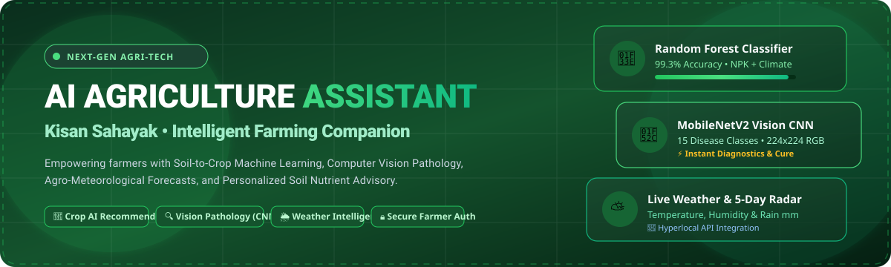
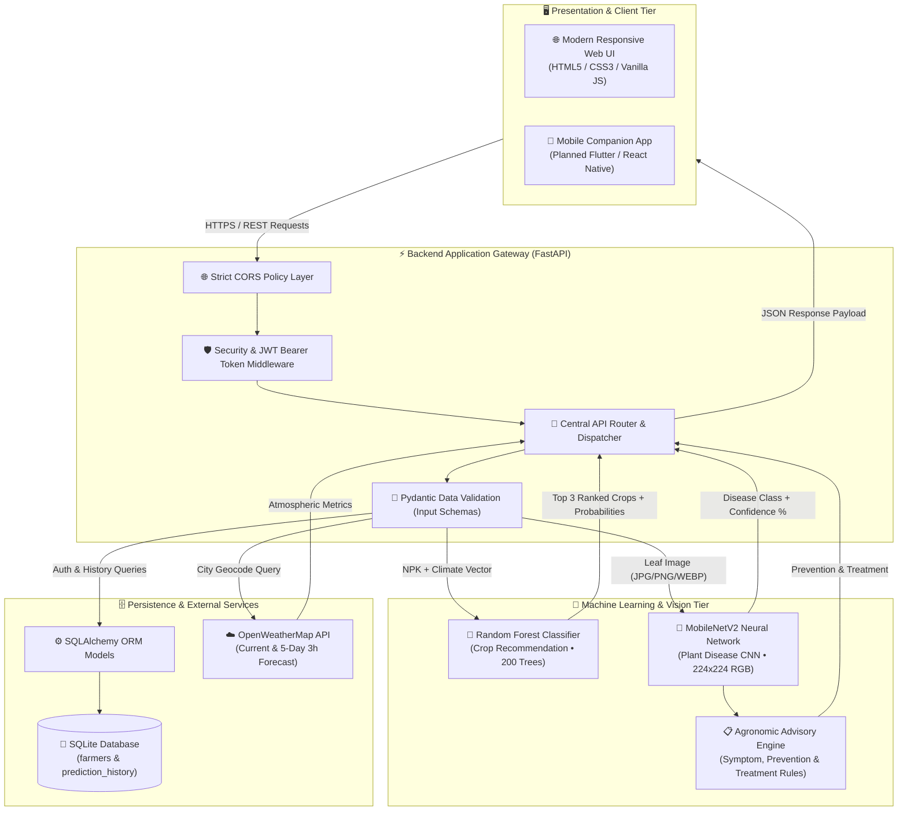
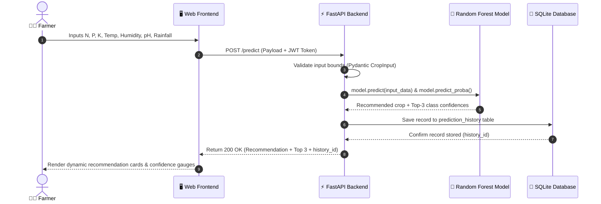
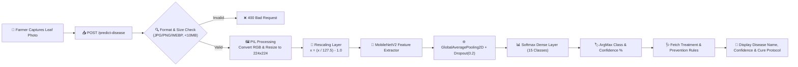
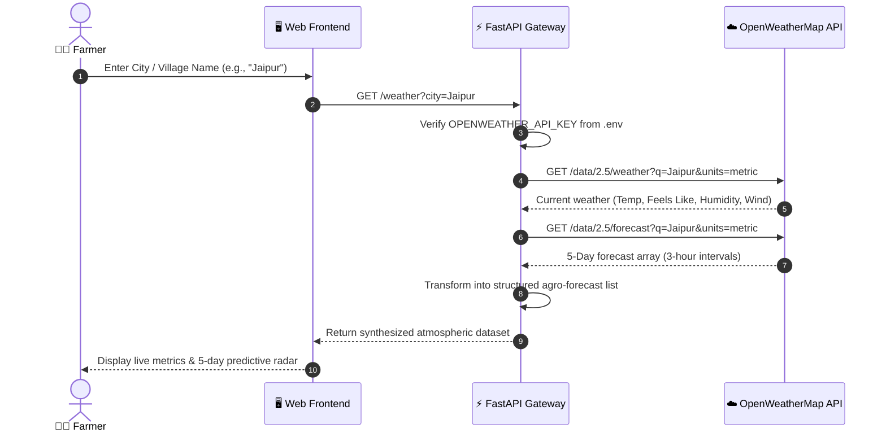
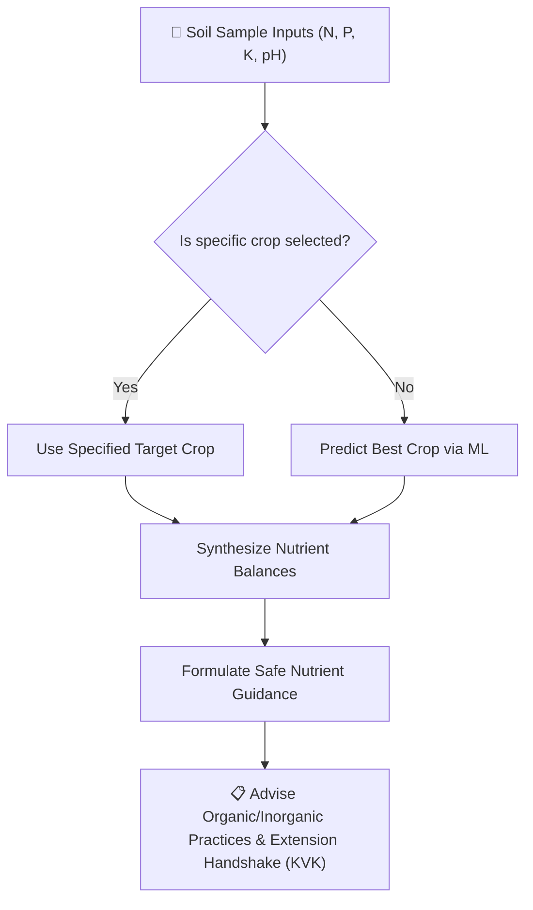
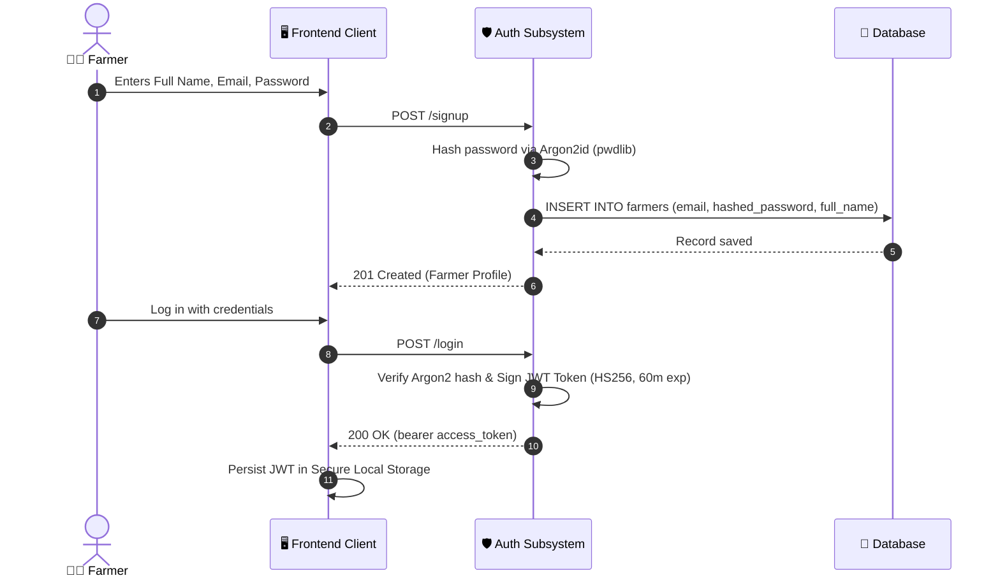
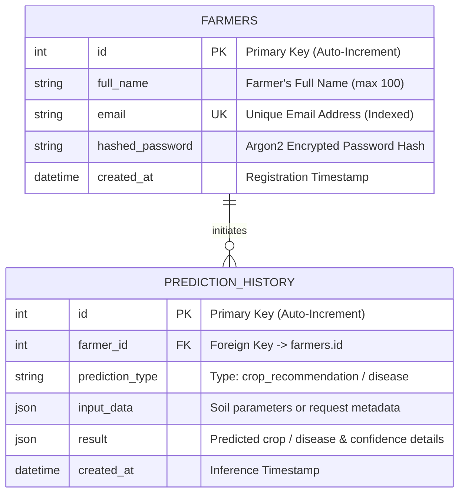

<p align="center">
  
</p>

<p align="center">
  <a href="https://fastapi.tiangolo.com/"></a>
  <a href="https://www.python.org/"></a>
  <a href="https://tensorflow.org/"></a>
  <a href="https://scikit-learn.org/"></a>
  <a href="https://www.sqlite.org/"></a>
  <a href="https://openweathermap.org/"></a>
</p>

<p align="center">
  
  
  
  
  
  
</p>

---

## 📌 Table of Contents

- [🌾 Overview & Mission](#-overview--mission)
- [✨ Key Capabilities](#-key-capabilities)
- [🏗️ System Architecture](#️-system-architecture)
- [🔄 Detailed Workflows & Logic](#-detailed-workflows--logic)
  - [1. Soil-to-Crop Recommendation Workflow](#1-soil-to-crop-recommendation-workflow)
  - [2. Vision-Based Plant Disease Diagnostics](#2-vision-based-plant-disease-diagnostics)
  - [3. Agro-Meteorological Weather Pipeline](#3-agro-meteorological-weather-pipeline)
  - [4. Soil Nutrient & Fertilizer Advisory](#4-soil-nutrient--fertilizer-advisory)
  - [5. Farmer Authentication & Audit History](#5-farmer-authentication--audit-history)
- [🧠 Machine Learning Specifications](#-machine-learning-specifications)
  - [Crop Recommendation Model (Random Forest)](#crop-recommendation-model-random-forest)
  - [Plant Disease Classifier (MobileNetV2 CNN)](#plant-disease-classifier-mobilenetv2-cnn)
- [🗄️ Database Schema](#️-database-schema)
- [📡 API Reference & Endpoints](#-api-reference--endpoints)
- [📂 Project Directory Tree](#-project-directory-tree)
- [🚀 Quickstart & Installation](#-quickstart--installation)
- [🧪 Model Training & Evaluation](#-model-training--evaluation)
- [🛡️ Security & Privacy](#️-security--privacy)
- [🗺️ Future Roadmap](#️-future-roadmap)
- [🤝 Contributing & License](#-contributing--license)

---

## 🌾 Overview & Mission

**AI Agriculture Assistant (Kisan Sahayak)** is an enterprise-grade, intelligent agronomy decision-support ecosystem crafted to bridge the digital divide for smallholder and commercial farmers. By harmonizing machine learning, computer vision, real-time meteorological intelligence, and agronomic science, the platform empowers agricultural producers to:

1. **Maximize Crop Yields:** Recommend the most viable and profitable crops for any specific soil composition (N, P, K, pH) and microclimate conditions.
2. **Eliminate Crop Losses:** Detect foliar plant diseases instantly using smartphone leaf photography powered by deep convolutional neural networks (MobileNetV2).
3. **Optimize Input Costs:** Deliver balanced nutrient advisories to prevent indiscriminate fertilizer usage and protect soil health.
4. **Mitigate Weather Risks:** Provide hyperlocal live atmospheric observations and 5-day predictive forecasts for targeted irrigation and harvesting schedules.
5. **Track Historical Decisions:** Enable registered farmers to maintain an immutable log of their soil tests, diagnoses, and harvest decisions.

---

## ✨ Key Capabilities

| Capability | Technology | Description |
| :--- | :--- | :--- |
| **🌱 Crop Recommendation** | Random Forest Classifier | Recommends optimal crops with top-3 confidence rankings from 7 geochemical parameters. |
| **🔬 Plant Disease Vision** | MobileNetV2 CNN Transfer Learning | Classifies 15 distinct pathological conditions across Pepper, Potato, and Tomato foliage. |
| **🩺 Agronomic Treatment** | Expert Knowledge Engine | Delivers verified prevention, management, and scientific treatment protocols for leaf conditions. |
| **🌦️ Hyperlocal Agro-Weather** | OpenWeatherMap 2.5 API | Generates real-time temperatures, humidity, wind vectors, and 5-day predictive rainfall trends. |
| **🧪 Fertilizer Guidance** | Soil NPK Ratio Evaluator | Guides farmers on soil fertility thresholds and directs them to local extension centers (KVK). |
| **🔐 Farmer Portal & History** | JWT & Argon2id + SQLAlchemy | Secure farmer signup, login, session tokens, and encrypted historical analytics audit trail. |

---

## 🏗️ System Architecture

The AI Agriculture Assistant adheres to a decoupled, high-throughput micro-architecture separating presentation, application gateway, machine learning inference engines, persistence layers, and external meteorological cloud APIs.



---

## 🔄 Detailed Workflows & Logic

### 1. Soil-to-Crop Recommendation Workflow

Farmers input their soil geochemical profile along with localized climatic data. The Random Forest model evaluates the input against historical multi-crop envelopes and outputs the primary recommendation alongside the top 3 alternatives with probabilistic confidences.



---

### 2. Vision-Based Plant Disease Diagnostics

Farmers upload or capture a photo of a suspicious leaf. The image is preprocessed and evaluated by a MobileNetV2 convolutional neural network trained on thousands of plant pathology samples.



---

### 3. Agro-Meteorological Weather Pipeline

Real-time agro-weather integration enables proactive farming decisions, such as scheduling pesticide sprays before high humidity or delaying irrigation when precipitation is imminent.



---

### 4. Soil Nutrient & Fertilizer Advisory



---

### 5. Farmer Authentication & Audit History



---

## 🧠 Machine Learning Specifications

### Crop Recommendation Model (Random Forest)

- **Algorithm:** `RandomForestClassifier` with Bootstrap Aggregation
- **Hyperparameters:**
  - `n_estimators`: 200 trees
  - `criterion`: Gini impurity
  - `class_weight`: `"balanced"`
  - `random_state`: 42
- **Training Dataset:** 2,200 curated agro-climatic observations across 22 crop labels (`data/Crop_recommendation.csv`).
- **Feature Vector (7 Features):**
  1. `N`: Nitrogen ratio in soil (0 - 300 kg/ha)
  2. `P`: Phosphorus ratio in soil (0 - 300 kg/ha)
  3. `K`: Potassium ratio in soil (0 - 300 kg/ha)
  4. `temperature`: Ambient temperature in Celsius (-10°C to 60°C)
  5. `humidity`: Relative atmospheric humidity (0 - 100%)
  6. `ph`: Soil pH level (0 - 14 scale)
  7. `rainfall`: Precipitation depth in mm (0 - 5000 mm)
- **Target Classes (22 Crops):**
  `rice`, `maize`, `chickpea`, `kidneybeans`, `pigeonpeas`, `mothbeans`, `mungbean`, `blackgram`, `lentil`, `pomegranate`, `banana`, `mango`, `grapes`, `watermelon`, `muskmelon`, `apple`, `orange`, `papaya`, `coconut`, `cotton`, `jute`, `coffee`.
- **Validation Metrics:**
  - **Test Accuracy:** **99.32%**
  - **Precision / Recall / F1-Score:** > 0.99 macro average across all 22 classes.

---

### Plant Disease Classifier (MobileNetV2 CNN)

- **Architecture:** Convolutional Neural Network with Pretrained MobileNetV2 Backbone (Transfer Learning via ImageNet weights).
- **Topology:**
  1. `Input`: Shape `(224, 224, 3)`
  2. `Rescaling`: Normalization layer `x = (x / 127.5) - 1.0` mapping pixel values to `[-1.0, 1.0]`
  3. `MobileNetV2 Base`: Feature extractor (frozen pretrained weights)
  4. `GlobalAveragePooling2D`: Spatial dimensionality reduction
  5. `Dropout(0.2)`: Regularization to prevent overfitting
  6. `Dense(15, activation='softmax')`: Multi-class probability distribution
- **Optimizer & Loss:** Adam (`lr=0.001`), `sparse_categorical_crossentropy`
- **Supported Pathological Classes (15):**
  ```
  1. Pepper__bell___Bacterial_spot
  2. Pepper__bell___healthy
  3. Potato___Early_blight
  4. Potato___Late_blight
  5. Potato___healthy
  6. Tomato_Bacterial_spot
  7. Tomato_Early_blight
  8. Tomato_Late_blight
  9. Tomato_Leaf_Mold
  10. Tomato_Septoria_leaf_spot
  11. Tomato_Spider_mites_Two_spotted_spider_mite
  12. Tomato__Target_Spot
  13. Tomato__Tomato_YellowLeaf__Curl_Virus
  14. Tomato__Tomato_mosaic_virus
  15. Tomato_healthy
  ```

---

## 🗄️ Database Schema

The persistence layer uses SQLite with SQLAlchemy Object-Relational Mapping (ORM). Foreign keys and cascade rules ensure referential integrity.



---

## 📡 API Reference & Endpoints

Interactive Swagger UI documentation is automatically hosted at `http://127.0.0.1:8000/docs`.

### Core Endpoints Matrix

| Method | Endpoint | Auth Required | Description | Sample Request Body |
| :---: | :--- | :---: | :--- | :--- |
| `GET` | `/` | ❌ No | Welcome message & API status | *None* |
| `GET` | `/health` | ❌ No | System & ML model readiness health check | *None* |
| `GET` | `/db-health` | ❌ No | SQLite database ping test | *None* |
| `POST` | `/signup` | ❌ No | Register a new farmer account | `{"full_name":"Ramesh Kumar","email":"ramesh@example.com","password":"StrongPassword123"}` |
| `POST` | `/login` | ❌ No | Authenticate & issue JWT Bearer token | `{"email":"ramesh@example.com","password":"StrongPassword123"}` |
| `GET` | `/me` | 🔒 Yes | Retrieve current logged-in farmer profile | *Bearer Token Header* |
| `POST` | `/predict` | 🔒 Yes | Predict recommended crop & save history | `{"N":90,"P":42,"K":43,"temperature":20.8,"humidity":82.0,"ph":6.5,"rainfall":202.9}` |
| `GET` | `/prediction-history` | 🔒 Yes | Fetch paginated historical predictions | `?limit=20` (Query Param) |
| `POST` | `/fertilizer-guidance`| ❌ No | Retrieve fertilizer dosage recommendations | `{"N":80,"P":40,"K":40,"temperature":25,"humidity":80,"ph":6.5,"rainfall":150,"crop":"rice"}` |
| `POST` | `/predict-disease` | ❌ No | Classify plant pathology from leaf image | `multipart/form-data` with `file: leaf.jpg` |
| `GET` | `/disease-guidance/{disease}` | ❌ No | Get symptoms, prevention & treatment | `disease_name` path param |
| `GET` | `/weather` | ❌ No | Current weather & 5-day predictive forecast | `?city=Jaipur` (Query Param) |

---

## 📂 Project Directory Tree

```
AI-AGRICULTURE-CHATBOT-/
│
├── .env.example                     # Environment variables configuration template
├── .gitignore                       # Production git ignore definitions
├── README.md                        # Master architectural documentation
├── requirements.txt                 # Python production dependencies
│
├── assets/                          # Multimedia & graphic resources
│   └── header-animation.svg         # Animated SVG hero banner
│
├── backend/                         # FastAPI Application Core
│   ├── __init__.py
│   ├── auth.py                      # Argon2 password hashing & JWT encoding/decoding
│   ├── auth_routes.py               # /signup, /login, /me endpoints
│   ├── dependencies.py              # Auth dependency injection (get_current_farmer)
│   ├── main.py                      # Core FastAPI app, routes & inference endpoints
│   ├── schemas.py                   # Pydantic schemas (Validation models)
│   │
│   └── database/                    # Persistence Subsystem
│       ├── __init__.py
│       ├── connection.py            # SQLite engine & session factory
│       ├── init_db.py               # Table initialization migration script
│       └── models.py                # SQLAlchemy Farmer & PredictionHistory models
│
├── data/                            # Datasets & Agronomic Data
│   └── Crop_recommendation.csv      # Soil NPK & meteorological dataset (22 crops)
│
├── frontend/                        # Web Presentation Client
│   └── index.html                   # Responsive SPA (Crop, Disease, Weather, Auth)
│
├── ml/                              # Machine Learning Pipeline
│   ├── check_quality.py             # Data quality & consistency validation
│   ├── crop_recommendation_model.joblib # Trained Random Forest model binary
│   ├── inspect_dataset.py           # Dataset statistics & feature exploration
│   ├── plant_disease_classes.json   # 15 plant pathology class indices
│   ├── plant_disease_model.keras    # Trained MobileNetV2 Deep Learning model
│   ├── prepare_data.py              # Data preprocessing and scaling routines
│   ├── test_crop_prediction.py      # Automated model inference unit verification
│   ├── train_crop_model.py          # Random Forest training & export pipeline
│   └── train_plant_disease.py       # MobileNetV2 Transfer Learning training script
│
├── docs/                            # Documentation artifacts & guides
└── mobile-app/                      # Mobile client development workspace
```

---

## 🚀 Quickstart & Installation

### Prerequisites
- Python 3.11+ or 3.12+
- Git installed on your system
- Modern Web Browser (Chrome, Edge, Firefox, Safari)

### 1. Clone the Repository
```bash
git clone https://github.com/sunilchoudhary8742com-byte/AI-AGRICULTURE-CHATBOT-.git
cd AI-AGRICULTURE-CHATBOT-
```

### 2. Set Up Virtual Environment
```bash
# Windows
python -m venv .venv
.venv\Scripts\activate

# Linux / macOS
python3 -m venv .venv
source .venv/bin/activate
```

### 3. Install Required Dependencies
```bash
pip install --upgrade pip
pip install -r requirements.txt
```

### 4. Configure Environment Variables
Copy the `.env.example` file to create your `.env`:
```bash
cp .env.example .env
```
Open `.env` and fill in your values:
```env
OPENWEATHER_API_KEY=your_openweathermap_api_key_here
SECRET_KEY=your_generated_jwt_secret_key_here
```
> **Tip:** You can obtain a free API key at [OpenWeatherMap](https://openweathermap.org/api).

### 5. Initialize the SQLite Database
```bash
python -m backend.database.init_db
```

### 6. Launch the FastAPI Backend Server
```bash
uvicorn backend.main:app --reload --host 127.0.0.1 --port 8000
```
- API Base: `http://127.0.0.1:8000`
- Interactive Swagger Docs: `http://127.0.0.1:8000/docs`
- Health Check: `http://127.0.0.1:8000/health`

### 7. Run the Web Frontend Client
You can open `frontend/index.html` directly in your browser or serve it using Python's built-in HTTP server or VS Code Live Server:
```bash
cd frontend
python -m http.server 5500
```
Access the UI at: `http://127.0.0.1:5500`

---

## 🧪 Model Training & Evaluation

To retrain the machine learning models with new datasets:

### Retrain Crop Recommender (Random Forest)
```bash
python ml/train_crop_model.py
```
*Evaluates the model, displays classification metrics, and exports `crop_recommendation_model.joblib`.*

### Test Inference
```bash
python ml/test_crop_prediction.py
```

### Retrain Plant Disease Model (MobileNetV2)
```bash
python ml/train_plant_disease.py
```
*Loads image batches, applies ImageNet transfer learning with data prefetching, and saves `plant_disease_model.keras`.*

---

## 🛡️ Security & Privacy

- **Password Cryptography:** Implements Argon2id hashing via `pwdlib` to defend against GPU brute-force attacks.
- **Stateless Tokens:** Employs industry-standard JWTs with 60-minute expiration windows.
- **Upload Hardening:** Restricts leaf image uploads strictly to verified MIME types (`image/jpeg`, `image/png`, `image/webp`) with a hard 10 MB limit.
- **Environment Isolation:** Secrets and API keys are strictly governed by environment variables and excluded from version control.

---

## 🗺️ Future Roadmap

- [ ] **Cross-Platform Mobile App:** Deploy dedicated Flutter and React Native mobile clients with offline support.
- [ ] **Vernacular Multilingual Voice Assistant:** Integrate conversational speech-to-speech AI in regional languages (Hindi, Punjabi, Telugu, Tamil, Bengali).
- [ ] **Remote Sensing & Satellite Indices:** Integrate Sentinel-2 / Landsat NDVI imagery to compute vegetation health remotely.
- [ ] **IoT Sensor Gateways:** Ingest live LoRaWAN telemetry from field soil sensors directly into the prediction pipeline.
- [ ] **Market Price Real-time Ticker:** Integrate e-NAM (National Agriculture Market) mandi prices for predicted crops.

---

## 🤝 Contributing & License

Contributions, issues, and feature requests are welcome!

1. Fork the repository
2. Create your feature branch (`git checkout -b feature/AmazingFeature`)
3. Commit your changes (`git commit -m 'Add some AmazingFeature'`)
4. Push to the branch (`git push origin feature/AmazingFeature`)
5. Open a Pull Request

Distributed under the **MIT License**. See `LICENSE` for more information.

<p align="center">
  <b>Built with ❤️ to empower farmers worldwide 🌾</b>
</p>
